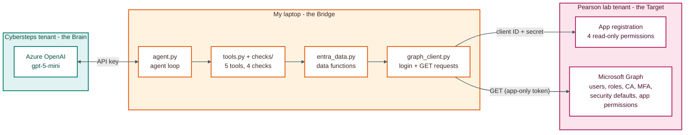
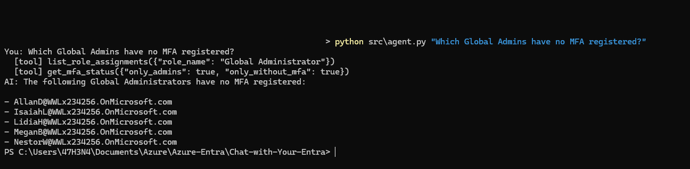

# Chat with Your Entra

An AI agent that reads a Microsoft Entra ID tenant through Microsoft Graph, finds security risks and explains how to fix them.

Built as part of the Cybersteps Purple Team program. Tested against a Pearson lab tenant and [EntraGoat](https://github.com/Semperis/EntraGoat) (scenarios 1-3).

## What it does
- Answers questions about the tenant with live data, for example "Who are the Global Admins?"
- Runs 4 security checks and writes each finding as: Finding, Severity, MITRE ATT&CK, Evidence, Why it is a risk, How to fix, Reference
- Maps each finding to MITRE ATT&CK techniques
- Writes a full audit report in Markdown
- Only reads data. The app registration has read-only permissions

## How it works



- **Cybersteps tenant (the Brain):** Azure OpenAI, model `gpt-5-mini`
- **My laptop (the Bridge):** the Python agent. It is the only part that talks to both tenants
- **Pearson lab tenant (the Target):** the Entra ID data being audited

More diagrams: [docs/architecture.md](docs/architecture.md)

## Security checks

| Check | Looks for | MITRE ATT&CK | Based on |
|---|---|---|---|
| `legacy_auth` | Legacy authentication not blocked (no security defaults, no CA policy blocking it) | T1110.003, T1078.004 | [Microsoft Learn](https://learn.microsoft.com/en-us/entra/identity/conditional-access/policy-block-legacy-authentication) |
| `admin_mfa` | Admins without MFA registered, and admins without enforced MFA | T1110.003, T1078.004 | [Microsoft Learn](https://learn.microsoft.com/en-us/entra/identity/role-based-access-control/best-practices) |
| `sp_privileges` | Apps with high-risk Graph permissions or admin roles | T1098.003, T1098.001, T1078.004 | [Microsoft Learn](https://learn.microsoft.com/en-us/entra/identity/role-based-access-control/best-practices) |
| `global_admins` | 5 or more Global Administrators | T1078.004 | [Microsoft Learn](https://learn.microsoft.com/en-us/entra/identity/role-based-access-control/best-practices) |

The checks collect the evidence in Python. The AI only explains the risk, and its fix steps come from the Microsoft guidance that each check returns. Details: [docs/audit-checklist.md](docs/audit-checklist.md)

## Results

Baseline (Pearson lab tenant), all 6 findings failed:

| Finding | Severity |
|---|---|
| Legacy authentication is not blocked | High |
| 5 admins have no MFA registered | High |
| MFA is not enforced for 6 admins | High |
| 9 high-risk Graph app permissions on 3 apps | High |
| 5 admin roles held by apps, 2 of them Global Administrator | High |
| 8 Global Administrator assignments | Medium |

After deploying EntraGoat scenarios 1-3:

| Check | Baseline | After EntraGoat |
|---|---|---|
| Admins without MFA registered | 5 | 8 |
| Admins without enforced MFA | 6 | 9 |
| High-risk Graph app permissions | 9 | 10 |
| Admin roles held by apps | 5 | 6 |
| Global Administrator assignments | 8 | 11 |

Reports written by the agent:
- [reports/baseline-report-v1.md](reports/baseline-report-v1.md) - first report, before the hallucination fixes
- [reports/baseline-report.md](reports/baseline-report.md) - baseline after the fixes
- [reports/entragoat-report.md](reports/entragoat-report.md) - with EntraGoat scenarios 1-3
- [reports/mitre-report.md](reports/mitre-report.md) - with MITRE ATT&CK mapping and severity count



## Project structure
```
Chat-with-Your-Entra/
├── stage0/            # Stage 0: hello chat, chat loop, system prompts, first tool agent
├── src/
│   ├── graph_client.py     # login (client credentials) and Graph GET requests
│   ├── entra_data.py       # data functions: users, roles, CA, MFA, security defaults, app permissions
│   ├── checks/             # 4 security checks + MITRE ATT&CK mapping
│   ├── tools.py            # 5 tools for the agent
│   ├── agent.py            # agent loop
│   ├── pull_entra_data.py  # Stage 1 summary without AI
│   ├── run_checks.py       # all checks without AI
│   └── audit_report.py     # agent writes a report to reports/
├── prompts/system_prompt.md
├── reports/           # audit reports
├── docs/              # writeup, architecture, audit checklist, reflection
└── screenshots/
```

## Setup

### 1. Python
```powershell
python -m venv .venv
.venv\Scripts\Activate.ps1
python -m pip install -r requirements.txt
copy .env.example .env
```

### 2. Azure OpenAI (AI tenant)
- Create an Azure OpenAI resource and deploy `gpt-5-mini`
- Put the endpoint, key and deployment name in `.env`

### 3. App registration (tenant to audit)
- Register a single-tenant app and create a client secret
- Add these Microsoft Graph **application** permissions and grant admin consent:

| Permission | Used for |
|---|---|
| `User.Read.All` | users and guests |
| `Directory.Read.All` | roles, role assignments, apps |
| `Policy.Read.All` | Conditional Access, security defaults |
| `AuditLog.Read.All` | MFA registration report (needs Entra ID P1 or P2) |

- Put the tenant ID, client ID and secret in `.env`

### 4. Run
```powershell
python src\graph_client.py                                   # connection test
python src\pull_entra_data.py                                # users, roles, CA policies, MFA
python src\run_checks.py                                     # all checks, no AI
python src\agent.py "Who are the Global Admins?"             # one question
python src\agent.py                                          # chat mode
python src\audit_report.py                                   # full audit report
```

## Limits
- Reads active role assignments only, not PIM eligible roles
- Groups inside Conditional Access policies are not resolved
- The MFA report needs Entra ID P1 or P2 and does not include disabled users
- Does not read who owns apps and groups, so it cannot show how a normal user could reach an admin role
- Tested with EntraGoat scenarios 1-3 only

## Documentation
- [Writeup](docs/writeup.md) - every stage: what I did, commands, challenges
- [Architecture](docs/architecture.md) - diagrams
- [Audit checklist](docs/audit-checklist.md)
- [Reflection](docs/reflection.md) - what was hard about building an AI for identity security

## Note
For lab and learning use. Run it only against tenants you are allowed to test. Never commit `.env`.
