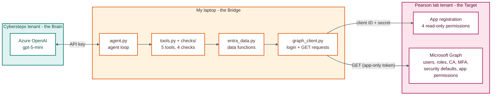
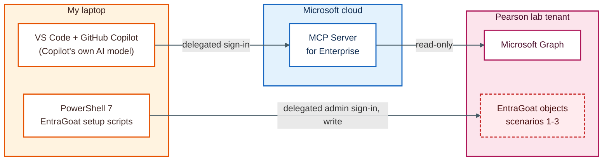
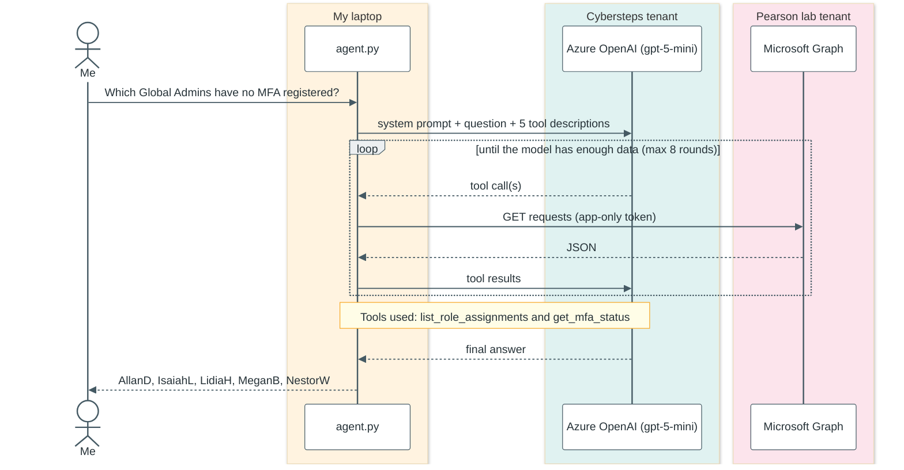
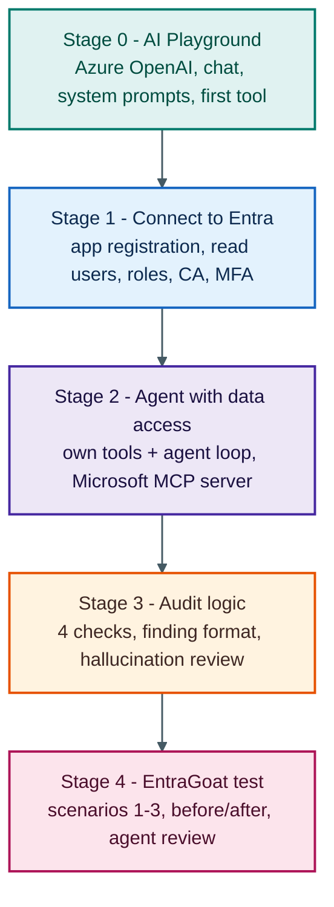

# How it works

## The setup

Three places. Only my laptop talks to both clouds, the two tenants never talk to each other.

- **Cybersteps tenant (the Brain):** Azure OpenAI with the model `gpt-5-mini`
- **My laptop (the Bridge):** the Python agent
- **Pearson lab tenant (the Target):** the Entra ID data I audit

- The agent sends the question and tool results to Azure OpenAI with an API key
- `graph_client.py` logs in with the app registration (client ID + secret) and only sends GET requests
- The app registration has 4 read-only permissions: `User.Read.All`, `Directory.Read.All`, `Policy.Read.All`, `AuditLog.Read.All`

## Other connections to the Pearson tenant

- **Microsoft MCP Server for Enterprise:** the second way I tested. VS Code signs in as me (delegated). It uses GitHub Copilot's own AI model, not my Azure OpenAI
- **EntraGoat:** the setup scripts ran in PowerShell 7 with my admin sign-in and created the vulnerable objects for scenarios 1-3

## One question, step by step

The model never calls Graph itself. It asks for a tool, my script runs it, and the result goes back to the model.

## Project stages

