# Chat with Your Entra - Writeup

## Phase 0 - Repo setup

### What I did
- Created an empty public repo `Chat-with-Your-Entra` on GitHub
- Added `.gitignore` so `.env`, `.venv/` and raw tenant data never go to GitHub
- Added `.env.example` with the variable names only, no values
- Added folders for each part of the project
- Made the first commit and pushed it to GitHub

### Commands
```powershell
git init -b main                 # start a git repo, default branch "main"
git add .                        # stage all files
git status                       # check that .env is not in the list
git commit -m "Initial commit: project structure, gitignore, env example"
git remote add origin https://github.com/4njuT0m/Chat-with-Your-Entra.git   # link the local repo to GitHub
git push -u origin main          # upload to GitHub
python -m venv .venv             # create a virtual environment for Python packages
.venv\Scripts\Activate.ps1       # activate it
```

### Challenges
- The first push was rejected: `GH007: Your push would publish a private email address`
- GitHub blocks pushes that show my private email in the commit
- Fix: used my GitHub noreply email in git, fixed the commit, pushed again

```powershell
git config --global user.email "<id>+4njuT0m@users.noreply.github.com"   # use the GitHub noreply email
git commit --amend --reset-author --no-edit                              # put the new email on the last commit
git push -u origin main
```

## Stage 0 - AI Playground

### What I did
- Created an Azure OpenAI resource `chat-with-entra-Ai` in the Cybersteps tenant
  - Resource group `rg-chat-with-entra`, region Germany West Central, Standard tier
- Deployed the model `gpt-5-mini` (version 2025-08-07, Global Standard)
- Saved the endpoint, key and deployment name in `.env`
- Installed the Python packages: `openai`, `python-dotenv`, `tzdata`
  - `tzdata` is needed on Windows for timezone names like `Asia/Tokyo`
- `stage0/hello_chat.py`: sends one question and prints the reply
  - The model explained what Entra ID is, 79 tokens used
- `stage0/chat_loop.py`: chat that keeps the message history
  - I said "I am from Germany", later asked "Where am I from?" and it answered "Germany"
  - The model has no memory itself. The script sends the full history every time
- `stage0/system_prompts.py`: same question with 3 different system prompts
  - Question: should every user get the Global Administrator role?
  - Friendly helper: long answer with alternatives and next steps
  - Strict security auditor: 3 bullet points, each starting with the security risk
  - JSON only: one line of JSON with `answer`, `risk` and `reason`
  - All three said no, only the format and tone changed
- `stage0/time_agent.py`: first agent with one tool, `get_current_time`
  - "What time is it in Tokyo?": the model asked for the tool with `Asia/Tokyo`, the script ran it, the model used the result
  - "What is 2+2?": no tool call, the model answered directly

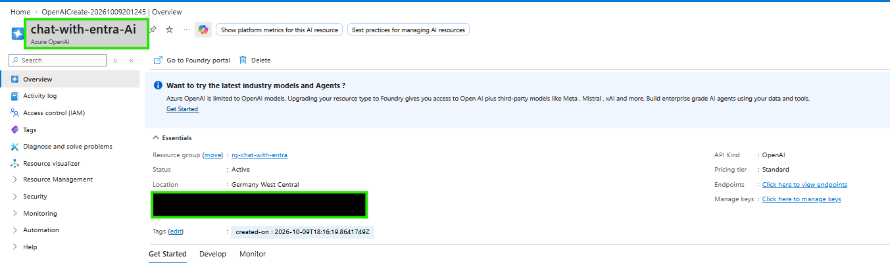
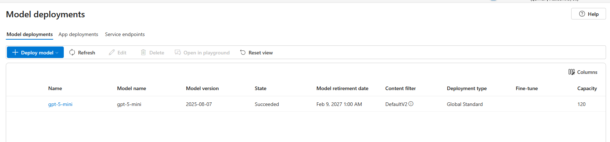
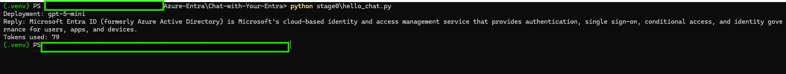
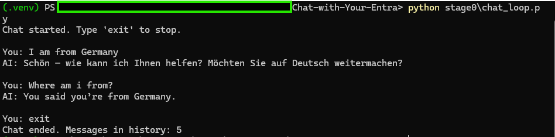
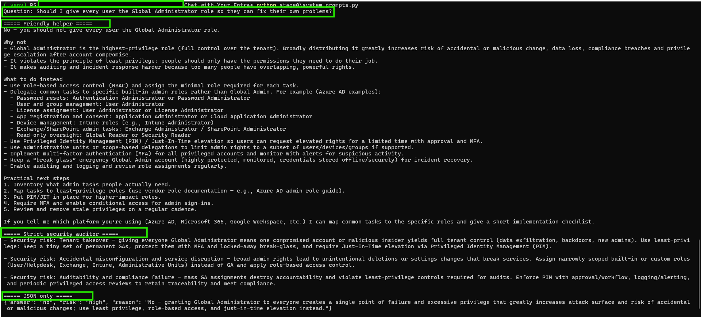
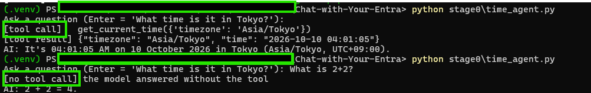

### Commands
```powershell
copy .env.example .env               # create my own .env from the template
notepad .env                         # add endpoint, key and deployment name
pip install -r requirements.txt      # install the Python packages
python stage0\hello_chat.py          # send one question to the model
python stage0\chat_loop.py           # chat with history, type exit to stop
python stage0\system_prompts.py      # same question, 3 system prompts
python stage0\time_agent.py          # agent that can call the time tool
```

### Challenges
- The project diagram shows GPT-4o, but every gpt-4o version is now deprecated or legacy in Azure
- I used `gpt-5-mini` instead (GA, retirement date Feb 2027, after this project ends)

## Stage 1 - Connecting to Entra

### What I did
- Registered an app `chat-with-your-entra-reader` in the Pearson lab tenant (Contoso), single tenant
- Created a client secret and saved tenant ID, client ID and secret in `.env`
- Added 4 Microsoft Graph application permissions and granted admin consent
  - `User.Read.All` - users and guests
  - `Directory.Read.All` - roles, role assignments, groups, apps
  - `Policy.Read.All` - Conditional Access policies
  - `AuditLog.Read.All` - MFA registration report
- Did not add `RoleManagement.Read.Directory`, because `Directory.Read.All` already covers role assignments
- `src/graph_client.py`: gets an app-only token (client credentials flow) and runs Graph GET requests, including paging
- `src/entra_data.py`: functions for users, role assignments, Conditional Access policies and MFA registration
- `src/pull_entra_data.py`: prints a summary and saves the raw JSON to `output/` (not in git)

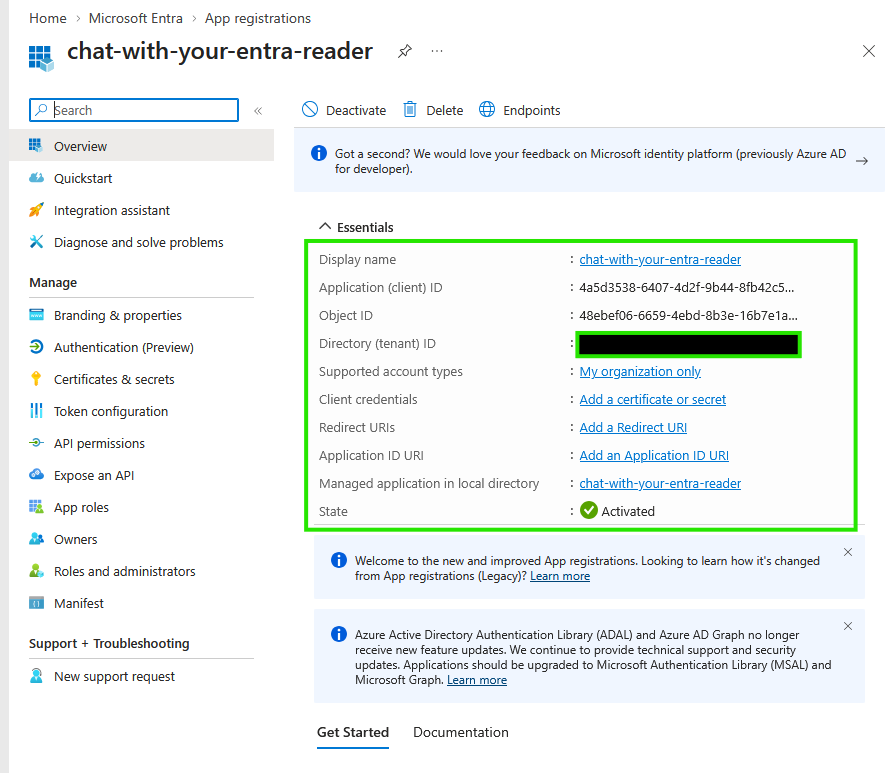
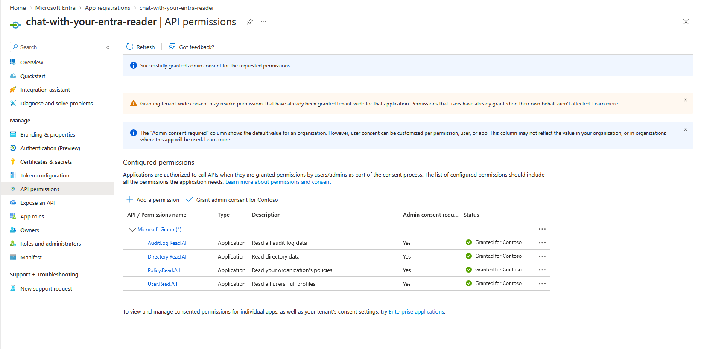
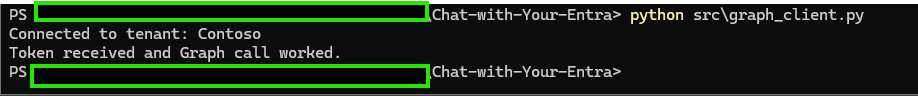
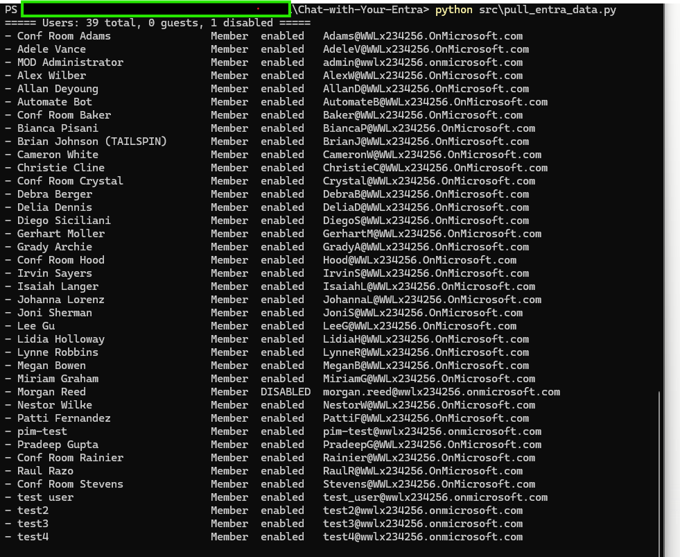
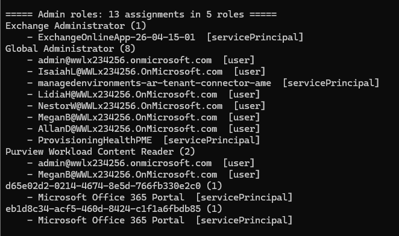
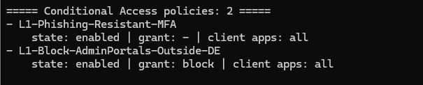
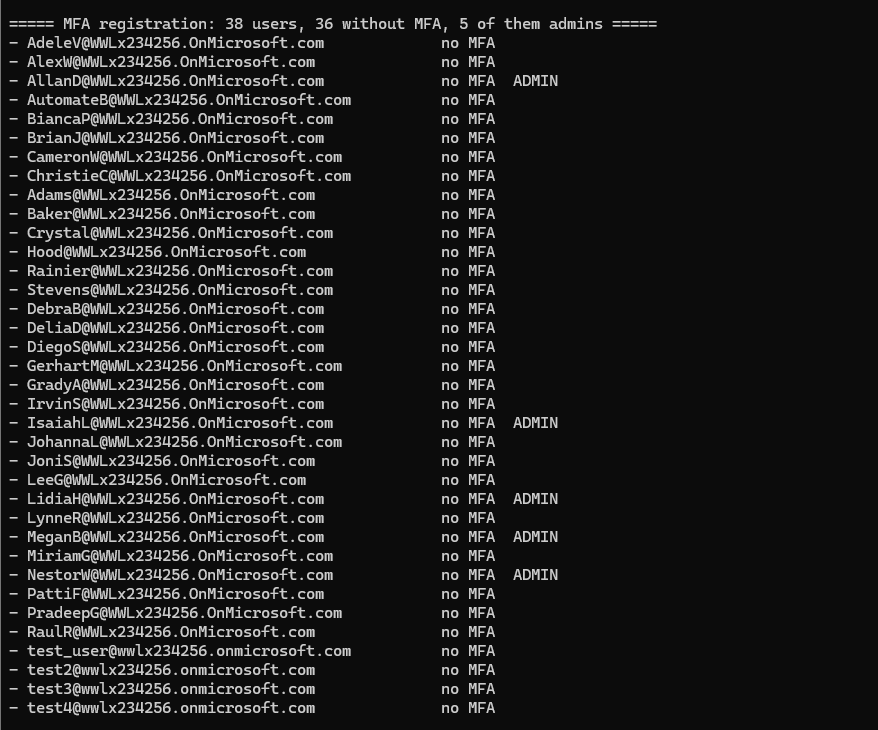

### Results
- 39 users, 0 guests, 1 disabled
- 13 active role assignments in 5 roles
- 8 Global Administrator assignments: 6 users and 2 service principals
- 2 Conditional Access policies, both enabled, both only for `test4`
- MFA report: 38 users, 36 without MFA

### Attacker view
- Global Admins are the main target: one account = full control of the tenant
- 5 of the 6 Global Admin users have no MFA (AllanD, IsaiahL, LidiaH, MeganB, NestorW). A guessed or phished password is enough
- 8 Global Admin assignments. Microsoft recommends fewer than 5
- 2 apps hold Global Admin (`managedenvironments-ar-tenant-connector-ame`, `ProvisioningHealthPME`). Apps can't do MFA, so whoever has their credentials is a Global Admin. They look like lab or Microsoft apps, so this is "review", not "malicious"
- The 2 Conditional Access policies only cover `test4`. No policy protects the admins or the other users
- No policy blocks legacy authentication (checked properly in Stage 3)
- 36 of 38 users have no MFA, so password spraying would likely work
- `pim-test` is marked as admin in the MFA report but has no active role. It probably has an eligible (PIM) role, which my script does not read yet

### Commands
```powershell
python -m pip install -r requirements.txt   # install msal and requests
python src\graph_client.py                  # connection test: prints the tenant name
python src\pull_entra_data.py               # users, admin roles, CA policies, MFA status
```

### Challenges
- `pip install` was blocked: `An Application Control policy has blocked this file`
  - Fix: `python -m pip install ...` runs pip through python.exe, which is allowed
- First Graph call failed: `403 Authorization_RequestDenied`
  - The token worked, but the permissions showed "Not granted for Contoso"
  - Fix: clicked "Grant admin consent for Contoso"
- 2 roles showed only an ID instead of a name
  - Some built-in roles are hidden from the role definitions list
  - Fix: also read `/directoryRoles` and ask for missing roles by ID. They were "AdHoc License Administrator" and "Email Verified User Creator"
- One CA policy showed no grant control
  - It uses an authentication strength (Phishing-resistant MFA), not the normal "mfa" control
  - Fix: the script now also prints the authentication strength

## Stage 2 - Giving the agent data access

### Part 1 - Own tools with function calling

#### What I did
- `src/tools.py`: turned the 4 Stage 1 functions into tools
  - `list_users`, `list_role_assignments`, `list_conditional_access_policies`, `get_mfa_status`
  - Each tool has a JSON description (what the model sees) and a Python function (what my script runs)
  - Results are trimmed to the fields that matter, so fewer tokens are sent
- `prompts/system_prompt.md`: rules for the AI
  - Use the tools, only state facts from tool results, never invent data, say when data is missing
  - Known limits: no PIM eligible roles, MFA report has no disabled users, "MFA registered" does not mean "MFA enforced"
- `src/agent.py`: agent loop
  - The model can call tools several times before it answers (max 8 rounds)
  - Every tool call is printed as `[tool] ...` so I can see what the agent does

#### Tests
- "Who are the Global Admins?"
  - 1 tool call: `list_role_assignments` with role name "Global Administrator"
  - Answer: 8 assignments, 6 users and 2 service principals
  - Same 8 as the Entra portal (Roles & admins > Global Administrator > Active assignments)
- "Which Global Admins have no MFA registered?"
  - 2 tool calls: `list_role_assignments` and `get_mfa_status` (only admins, only without MFA)
  - Answer: AllanD, IsaiahL, LidiaH, MeganB, NestorW. Same as my Stage 1 result
- "Are the admins protected by Conditional Access?"
  - 2 tool calls: `list_role_assignments` and `list_conditional_access_policies`
  - Answer: no. Both policies only include `test4` and target no roles
  - The agent also found that `admin@` is excluded from both policies. My Stage 1 script did not print exclusions, so I missed this
- "What is the password expiry policy?"
  - No tool call. It said the tools don't return password policy data. Good, it did not make up a tenant setting
  - But its "how to check it yourself" tips were outdated: it used the old name "Azure AD" and suggested the MSOnline and AzureAD PowerShell modules, which Microsoft has retired

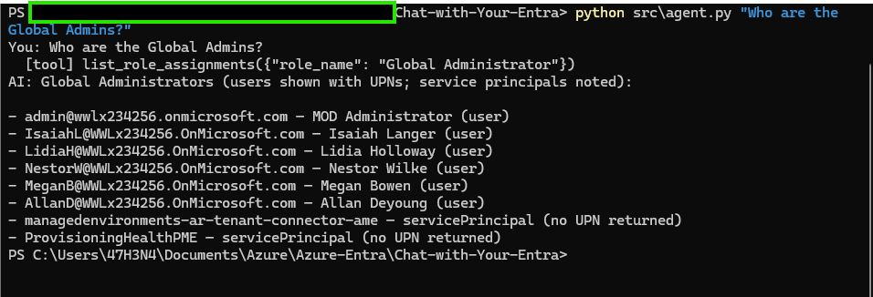
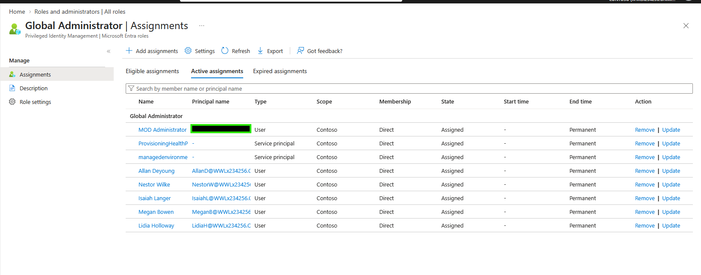

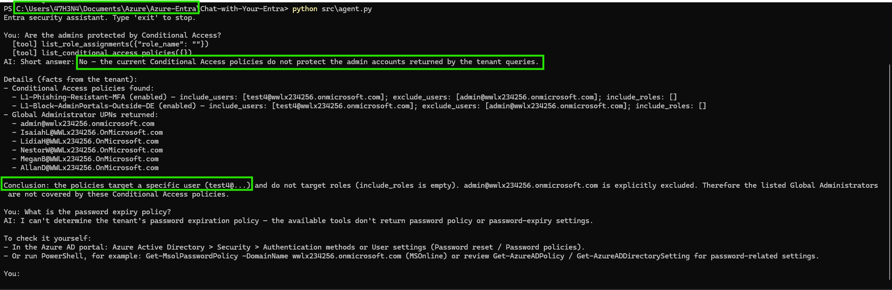

#### Commands
```powershell
python src\tools.py                                                   # run every tool once without the AI
python src\agent.py "Who are the Global Admins?"                      # one question, then exit
python src\agent.py "Which Global Admins have no MFA registered?"     # needs 2 tools
python src\agent.py                                                   # chat mode, type exit to stop
```

#### What I learned
- Tenant data from tools was correct every time I checked it against the portal or Stage 1
- General advice from the model's own knowledge can be outdated. Tool data can be trusted more than the model's memory
