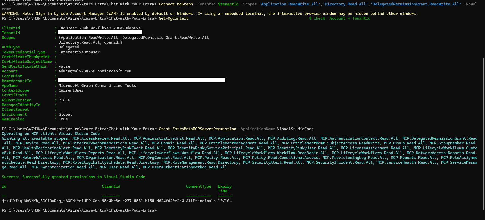
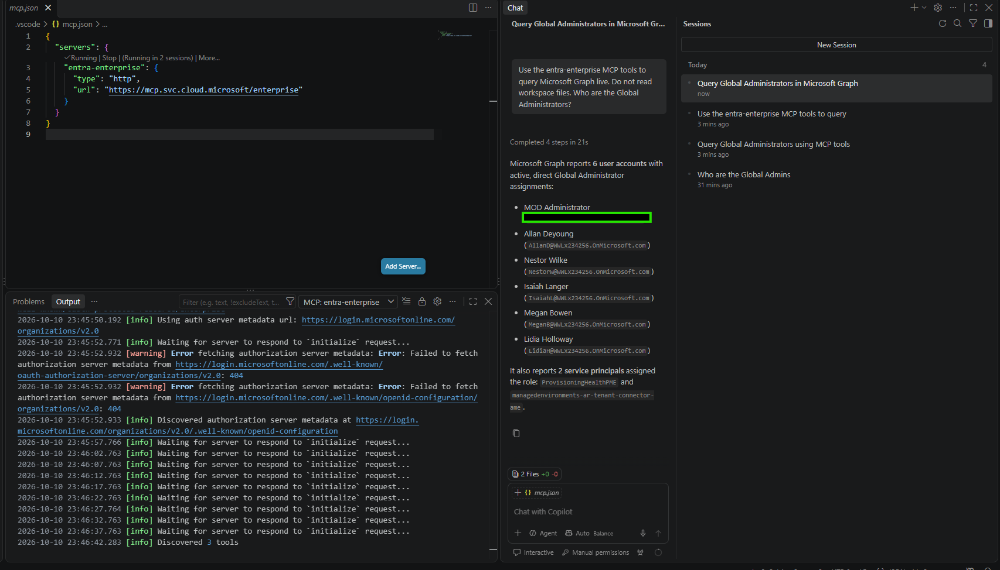
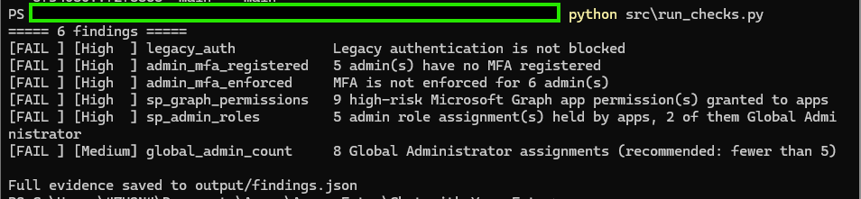
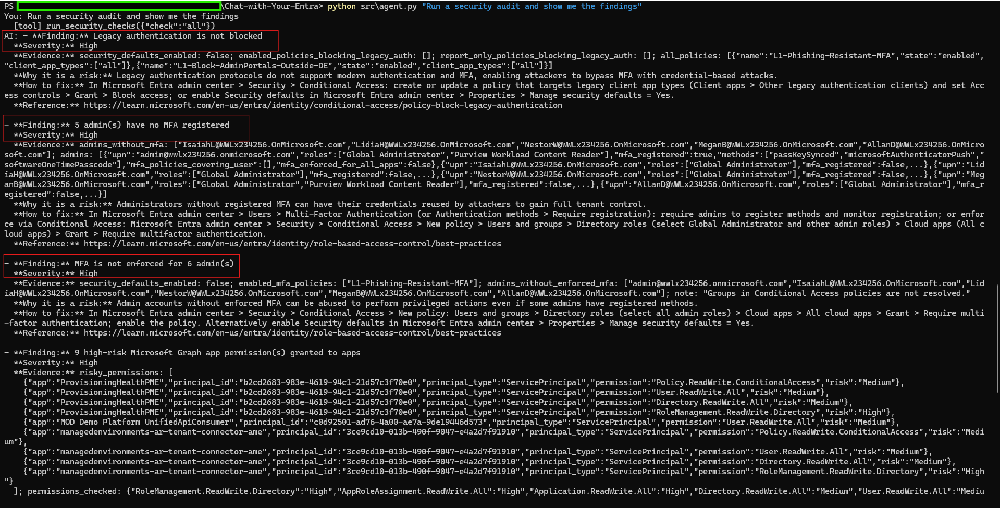
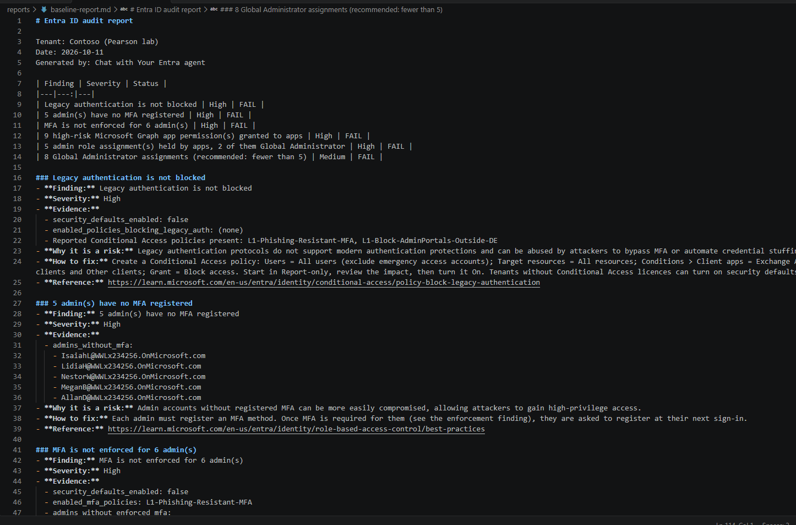
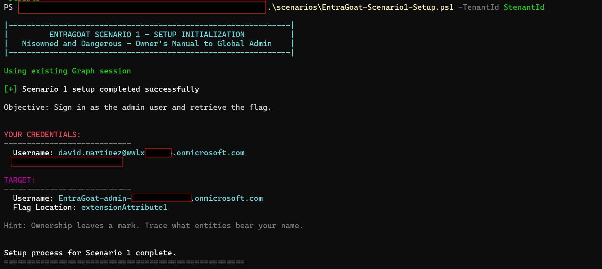
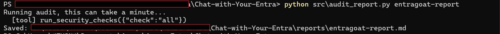

# Chat with Your Entra - Writeup

## Phase 0 - Repo setup

### What I did
- Created an empty public repo `Chat-with-Your-Entra` on GitHub
- Added `.gitignore` so `.env`, `.venv/` and raw tenant data never go to GitHub
- Added `.env.example` with the variable names only, no values
- Added folders for each part of the project
- Made the first commit and pushed it to GitHub

### Commands
```powershell
git init -b main                 # start a git repo, default branch "main"
git add .                        # stage all files
git status                       # check that .env is not in the list
git commit -m "Initial commit: project structure, gitignore, env example"
git remote add origin https://github.com/4njuT0m/Chat-with-Your-Entra.git   # link the local repo to GitHub
git push -u origin main          # upload to GitHub
python -m venv .venv             # create a virtual environment for Python packages
.venv\Scripts\Activate.ps1       # activate it
```

### Challenges
- The first push was rejected: `GH007: Your push would publish a private email address`
- GitHub blocks pushes that show my private email in the commit
- Fix: used my GitHub noreply email in git, fixed the commit, pushed again

```powershell
git config --global user.email "<id>+4njuT0m@users.noreply.github.com"   # use the GitHub noreply email
git commit --amend --reset-author --no-edit                              # put the new email on the last commit
git push -u origin main
```

## Stage 0 - AI Playground

### What I did
- Created an Azure OpenAI resource `chat-with-entra-Ai` in the Cybersteps tenant
  - Resource group `rg-chat-with-entra`, region Germany West Central, Standard tier
- Deployed the model `gpt-5-mini` (version 2025-08-07, Global Standard)
- Saved the endpoint, key and deployment name in `.env`
- Installed the Python packages: `openai`, `python-dotenv`, `tzdata`
  - `tzdata` is needed on Windows for timezone names like `Asia/Tokyo`
- `stage0/hello_chat.py`: sends one question and prints the reply
  - The model explained what Entra ID is, 79 tokens used
- `stage0/chat_loop.py`: chat that keeps the message history
  - I said "I am from Germany", later asked "Where am I from?" and it answered "Germany"
  - The model has no memory itself. The script sends the full history every time
- `stage0/system_prompts.py`: same question with 3 different system prompts
  - Question: should every user get the Global Administrator role?
  - Friendly helper: long answer with alternatives and next steps
  - Strict security auditor: 3 bullet points, each starting with the security risk
  - JSON only: one line of JSON with `answer`, `risk` and `reason`
  - All three said no, only the format and tone changed
- `stage0/time_agent.py`: first agent with one tool, `get_current_time`
  - "What time is it in Tokyo?": the model asked for the tool with `Asia/Tokyo`, the script ran it, the model used the result
  - "What is 2+2?": no tool call, the model answered directly


### Commands
```powershell
copy .env.example .env               # create my own .env from the template
notepad .env                         # add endpoint, key and deployment name
pip install -r requirements.txt      # install the Python packages
python stage0\hello_chat.py          # send one question to the model
python stage0\chat_loop.py           # chat with history, type exit to stop
python stage0\system_prompts.py      # same question, 3 system prompts
python stage0\time_agent.py          # agent that can call the time tool
```

### Challenges
- The project diagram shows GPT-4o, but every gpt-4o version is now deprecated or legacy in Azure
- I used `gpt-5-mini` instead (GA, retirement date Feb 2027, after this project ends)

## Stage 1 - Connecting to Entra

### What I did
- Registered an app `chat-with-your-entra-reader` in the Pearson lab tenant (Contoso), single tenant
- Created a client secret and saved tenant ID, client ID and secret in `.env`
- Added 4 Microsoft Graph application permissions and granted admin consent
  - `User.Read.All` - users and guests
  - `Directory.Read.All` - roles, role assignments, groups, apps
  - `Policy.Read.All` - Conditional Access policies
  - `AuditLog.Read.All` - MFA registration report
- Did not add `RoleManagement.Read.Directory`, because `Directory.Read.All` already covers role assignments
- `src/graph_client.py`: gets an app-only token (client credentials flow) and runs Graph GET requests, including paging
- `src/entra_data.py`: functions for users, role assignments, Conditional Access policies and MFA registration
- `src/pull_entra_data.py`: prints a summary and saves the raw JSON to `output/` (not in git)


### Results
- 39 users, 0 guests, 1 disabled
- 13 active role assignments in 5 roles
- 8 Global Administrator assignments: 6 users and 2 service principals
- 2 Conditional Access policies, both enabled, both only for `test4`
- MFA report: 38 users, 36 without MFA

### Attacker view
- Global Admins are the main target: one account = full control of the tenant
- 5 of the 6 Global Admin users have no MFA (AllanD, IsaiahL, LidiaH, MeganB, NestorW). A guessed or phished password is enough
- 8 Global Admin assignments. Microsoft recommends fewer than 5
- 2 apps hold Global Admin (`managedenvironments-ar-tenant-connector-ame`, `ProvisioningHealthPME`). Apps can't do MFA, so whoever has their credentials is a Global Admin. They look like lab or Microsoft apps, so this is "review", not "malicious"
- The 2 Conditional Access policies only cover `test4`. No policy protects the admins or the other users
- No policy blocks legacy authentication (checked properly in Stage 3)
- 36 of 38 users have no MFA, so password spraying would likely work
- `pim-test` is marked as admin in the MFA report but has no active role. It probably has an eligible (PIM) role, which my script does not read yet

### Commands
```powershell
python -m pip install -r requirements.txt   # install msal and requests
python src\graph_client.py                  # connection test: prints the tenant name
python src\pull_entra_data.py               # users, admin roles, CA policies, MFA status
```

### Challenges
- `pip install` was blocked: `An Application Control policy has blocked this file`
  - Fix: `python -m pip install ...` runs pip through python.exe, which is allowed
- First Graph call failed: `403 Authorization_RequestDenied`
  - The token worked, but the permissions showed "Not granted for Contoso"
  - Fix: clicked "Grant admin consent for Contoso"
- 2 roles showed only an ID instead of a name
  - Some built-in roles are hidden from the role definitions list
  - Fix: also read `/directoryRoles` and ask for missing roles by ID. They were "AdHoc License Administrator" and "Email Verified User Creator"
- One CA policy showed no grant control
  - It uses an authentication strength (Phishing-resistant MFA), not the normal "mfa" control
  - Fix: the script now also prints the authentication strength

## Stage 2 - Giving the agent data access

### Part 1 - Own tools with function calling

#### What I did
- `src/tools.py`: turned the 4 Stage 1 functions into tools
  - `list_users`, `list_role_assignments`, `list_conditional_access_policies`, `get_mfa_status`
  - Each tool has a JSON description (what the model sees) and a Python function (what my script runs)
  - Results are trimmed to the fields that matter, so fewer tokens are sent
- `prompts/system_prompt.md`: rules for the AI
  - Use the tools, only state facts from tool results, never invent data, say when data is missing
  - Known limits: no PIM eligible roles, MFA report has no disabled users, "MFA registered" does not mean "MFA enforced"
- `src/agent.py`: agent loop
  - The model can call tools several times before it answers (max 8 rounds)
  - Every tool call is printed as `[tool] ...` so I can see what the agent does

#### Tests
- "Who are the Global Admins?"
  - 1 tool call: `list_role_assignments` with role name "Global Administrator"
  - Answer: 8 assignments, 6 users and 2 service principals
  - Same 8 as the Entra portal (Roles & admins > Global Administrator > Active assignments)
- "Which Global Admins have no MFA registered?"
  - 2 tool calls: `list_role_assignments` and `get_mfa_status` (only admins, only without MFA)
  - Answer: AllanD, IsaiahL, LidiaH, MeganB, NestorW. Same as my Stage 1 result
- "Are the admins protected by Conditional Access?"
  - 2 tool calls: `list_role_assignments` and `list_conditional_access_policies`
  - Answer: no. Both policies only include `test4` and target no roles
  - The agent also found that `admin@` is excluded from both policies. My Stage 1 script did not print exclusions, so I missed this
- "What is the password expiry policy?"
  - No tool call. It said the tools don't return password policy data. Good, it did not make up a tenant setting
  - But its "how to check it yourself" tips were outdated: it used the old name "Azure AD" and suggested the MSOnline and AzureAD PowerShell modules, which Microsoft has retired


#### Commands
```powershell
python src\tools.py                                                   # run every tool once without the AI
python src\agent.py "Who are the Global Admins?"                      # one question, then exit
python src\agent.py "Which Global Admins have no MFA registered?"     # needs 2 tools
python src\agent.py                                                   # chat mode, type exit to stop
```

#### What I learned
- Tenant data from tools was correct every time I checked it against the portal or Stage 1
- General advice from the model's own knowledge can be outdated. Tool data can be trusted more than the model's memory

### Part 2 - Microsoft MCP Server for Enterprise

#### What I did
- Turned on the Microsoft MCP Server for Enterprise in the Pearson tenant with PowerShell 7
  - Signed in with `Connect-MgGraph` as the Pearson admin (delegated)
  - Ran `Grant-EntraBetaMCPServerPermission -ApplicationName VisualStudioCode`
  - Output: "Successfully granted permissions to Visual Studio Code"
- Added the server to VS Code as a workspace server in `.vscode/mcp.json`, name `entra-enterprise`
- VS Code found 3 tools on the server
- Signed in to the server with the Pearson admin account
- Asked Copilot (Agent mode) "Who are the Global Administrators?"
  - Answer: 6 users and 2 service principals
  - Same 8 as my own agent and the Entra portal




#### Commands
```powershell
pwsh -NoProfile                                                     # PowerShell 7, nothing preloaded
Install-Module Microsoft.Entra.Beta -Scope CurrentUser -Force -AllowClobber   # Entra PowerShell module
Import-Module Microsoft.Graph.Authentication                         # Graph login module
$tenantId = (Select-String -Path .env -Pattern '^PEARSON_TENANT_ID=(.+)$').Matches[0].Groups[1].Value.Trim()   # read tenant ID from .env
Connect-MgGraph -TenantId $tenantId -Scopes 'Application.ReadWrite.All','Directory.Read.All','DelegatedPermissionGrant.ReadWrite.All' -NoWelcome   # sign in as admin
Get-MgContext                                                       # check account and tenant
Grant-EntraBetaMCPServerPermission -ApplicationName VisualStudioCode   # register the MCP server and allow VS Code
```

#### Security notes
- The cmdlet granted all available scopes, about 40 `MCP.*` scopes
  - One of them is a write scope: `MCP.EntitlementMgmt-SubjectAccess.ReadWrite`
  - The cmdlet also takes `-Scopes`, so it can be limited to what is needed
- Consent type is `AllPrincipals`: every user in the tenant can use VS Code with this server
  - It is delegated, so each user still only sees what their own account can see

#### Own agent vs MCP server

| | My own agent | Microsoft MCP Server |
|---|---|---|
| Login | App-only, client secret | Delegated, signed-in user |
| Tools | 4 tools I wrote | 3 generic tools that run read-only Graph queries |
| What it can read | Only what my tools return | Any Graph data the user and scopes allow |
| Control | I decide which data and fields go to the model | The model writes the Graph queries itself |
| Setup | App registration + 4 permissions | PowerShell provisioning + VS Code sign-in |

#### Challenges
- The first PowerShell 7 window closed with exit code 2, and Windows PowerShell 5.1 could not load the module
  - Fix: used PowerShell 7 with `pwsh -NoProfile`
- `Install-Module` warned that `Microsoft.Graph.Authentication` was in use and could not update it
- `Connect-Entra` failed: `Unable to find type [Microsoft.Graph.PowerShell.Authentication.ContextScope]`
  - Fix: signed in with `Connect-MgGraph` instead. `Grant-EntraBetaMCPServerPermission` worked with that session
- I typed the placeholder text instead of the tenant ID: `AADSTS900023`
  - Fix: read the tenant ID from `.env` with `Select-String`
- VS Code "Add Server" created `.mcp.json` with spaces in front of the name and URL, and the server did not start
  - Copilot then answered from my own `docs/writeup.md` instead of live data, and the answer was incomplete (it missed `admin@`)
  - Fix: created `.vscode/mcp.json` in the VS Code format
- Next, the server showed "Authentication Required" and Copilot said the MCP tools were not available
  - It did not make up an answer, which was good
  - Fix: clicked "Authentication Required" and signed in with the Pearson admin

#### What I learned
- An AI assistant with access to local files can answer from old notes instead of live data. I have to check where an answer came from
- The MCP server is quick to set up and very flexible, but it gives the model much more access than my own 4 tools

## Stage 3 - Audit logic

### What I did
- Wrote `docs/audit-checklist.md` with 4 checks, each based on Microsoft documentation
- Added 2 data functions to `src/entra_data.py`
  - Security defaults on or off (`/policies/identitySecurityDefaultsEnforcementPolicy`)
  - Which apps have Microsoft Graph application permissions (`appRoleAssignedTo` on the Microsoft Graph service principal)
  - No new API permissions were needed. `Directory.Read.All` and `Policy.Read.All` already cover them
- Wrote one Python file per check in `src/checks/`
  - `legacy_auth.py` - is legacy authentication blocked by security defaults or a CA policy?
  - `admin_mfa.py` - do admins have MFA registered, and is MFA enforced for them?
  - `sp_privileges.py` - apps with high-risk Graph permissions or admin roles
  - `global_admins.py` - fewer than 5 Global Admins?
- The checks collect the evidence. The AI only explains the risk and the fix
- Added the tool `run_security_checks` to the agent
- Updated the system prompt with a finding format: Finding, Severity, Evidence, Why it is a risk, How to fix, Reference
- `src/audit_report.py`: the agent runs the full audit and saves a Markdown report in `reports/`

### Results
| Check | Status | Severity | Finding |
|---|---|---|---|
| legacy_auth | FAIL | High | Legacy authentication is not blocked |
| admin_mfa_registered | FAIL | High | 5 admins have no MFA registered |
| admin_mfa_enforced | FAIL | High | MFA is not enforced for 6 admins |
| sp_graph_permissions | FAIL | High | 9 high-risk Graph permissions on 3 apps |
| sp_admin_roles | FAIL | High | 5 admin roles held by apps, 2 of them Global Administrator |
| global_admin_count | FAIL | Medium | 8 Global Administrator assignments |

- `admin@` has MFA registered, but no policy forces it. It is excluded from both CA policies
- 2 apps (`ProvisioningHealthPME`, `managedenvironments-ar-tenant-connector-ame`) have `RoleManagement.ReadWrite.Directory` and the Global Administrator role
- Security defaults are off and no CA policy blocks legacy authentication





### Hallucination check of the first report
I compared the first report (`reports/baseline-report-v1.md`) with the raw tool data in `output/findings.json`.

- Facts: no hallucination. All users, apps, permissions and numbers matched the tool data
- The "How to fix" parts came from the model's own knowledge and had problems:

| What the AI wrote | Problem |
|---|---|
| Block legacy auth for "Other clients" | Incomplete. Microsoft says Exchange ActiveSync and Other clients, for all users, exclude emergency accounts |
| "Authentication methods > Require registration" | This menu does not exist |
| "Users > Per-user MFA" | Old method. Microsoft recommends Conditional Access |
| Check that "L1-Phishing-Resistant-MFA" has "Require MFA" | That policy uses an authentication strength, not "Require MFA" |
| Remove the permissions from the lab apps | No warning that removing them can break Microsoft or lab apps |

- Also: the evidence was raw JSON and the report had 2 titles

### What I changed
- Each check now returns a `microsoft_guidance` field with the fix taken from the Microsoft docs
- New prompt rules
  - "How to fix" must be based only on `microsoft_guidance`, no invented menu paths
  - Evidence as a short list, never raw JSON
  - No extra title in the report
- Second report (`reports/baseline-report.md`)
  - Same facts as before, all correct
  - Fixes now match the Microsoft guidance word for word
  - Evidence is readable and the app warning is included

### Commands
```powershell
python src\run_checks.py                                            # run all checks without the AI
python src\agent.py "Run a security audit and show me the findings"  # agent uses run_security_checks
python src\audit_report.py                                          # agent writes reports\baseline-report.md
```

### Challenges
- The first report had made-up and outdated fix steps (see the table above)
  - Fix: moved the fix steps from the model's memory into the tool output (`microsoft_guidance`) and tightened the prompt
- The evidence was pasted as raw JSON, which was hard to read
  - Fix: prompt rule "short list, never raw JSON"

### What I learned
- Let code collect the facts and let the AI explain them. The facts were always right
- The model's own knowledge is the weak point. Giving it the official guidance in the tool result stopped the made-up steps
- Every AI report needs a check against the raw data before I trust it

## Stage 4 - EntraGoat test

### What I did
- Downloaded EntraGoat from `github.com/Semperis/EntraGoat` into a folder outside my repo
- Installed the Microsoft Graph PowerShell SDK (`Install-Module Microsoft.Graph -Scope CurrentUser`)
- Deployed scenarios 1, 2 and 3 in the Pearson lab tenant with the setup scripts
  - 1: Misowned and Dangerous - Owner's Manual to Global Admin
  - 2: Graph Me the Crown (and Role)
  - 3: Group MemberShipwreck - Sailed into Admin Waters
- Saved the scenario credentials and hints in a notes file outside the repo
- Ran my checks and my agent again and compared with the Stage 3 baseline
- Let the agent write `reports/entragoat-report.md`




### Before and after EntraGoat
| Check | Baseline | After scenarios 1-3 |
|---|---|---|
| Admins without MFA registered | 5 | 8 |
| Admins without enforced MFA | 6 | 9 |
| High-risk Graph app permissions | 9 | 10 |
| Admin roles held by apps | 5 | 6 |
| Global Administrator assignments | 8 | 11 |

New objects the agent found:
- 3 new Global Admins without MFA: `EntraGoat-admin-s1`, `EntraGoat-admin-s2`, `EntraGoat-admin-s3`
- App `Corporate Finance Analytics` with `AppRoleAssignment.ReadWrite.All` (High)
- App `Finance Analytics Dashboard` with the role Privileged Authentication Administrator

### Agent test
- Question: "Find privilege escalation paths: which low-privilege users or apps could become Global Admin?"
- The agent called `run_security_checks` and listed the apps with dangerous permissions and admin roles
- All facts were correct
- But it named no users, and it did not say that it had no data to answer that part. The answer looked complete but was not

### Review: how did the agent do?
- Good: every number, user, app and permission matched the raw tool data, in the chat answer and in the report
- Good: it spotted all new EntraGoat admins and both new risky apps right away
- Missed: how a normal user could reach these admins. My tools do not read who owns which apps and groups, so the agent cannot see these paths
- Missed: it did not say what it could not see
- Check gap: `sp_admin_roles` only treats Global Administrator as critical. Privileged Authentication Administrator, held by `Finance Analytics Dashboard`, is also a very powerful role and should be marked as critical too
- Not tested: scenarios 4, 5 and 6
- I will look at the attack paths by hand in my EntraGoat walkthrough project

### Commands
```powershell
cd ..\EntraGoat                                                    # EntraGoat folder, outside my repo
pwsh -NoProfile                                                    # PowerShell 7
Install-Module Microsoft.Graph -Scope CurrentUser -Force           # Graph PowerShell SDK
$tenantId = (Select-String -Path ..\Chat-with-Your-Entra\.env -Pattern '^PEARSON_TENANT_ID=(.+)$').Matches[0].Groups[1].Value.Trim()
Connect-MgGraph -TenantId $tenantId -NoWelcome -ContextScope Process -Scopes "Application.ReadWrite.All","AppRoleAssignment.ReadWrite.All","User.ReadWrite.All","Directory.ReadWrite.All","RoleManagement.ReadWrite.Directory","Group.ReadWrite.All","GroupMember.ReadWrite.All"   # sign in once, keep it in this window only
function Connect-MgGraph { if (Get-MgContext) { Write-Host "Using existing Graph session" } else { Microsoft.Graph.Authentication\Connect-MgGraph @args } }   # scripts reuse my sign-in
.\scenarios\EntraGoat-Scenario1-Setup.ps1 -TenantId $tenantId     # same for scenario 2 and 3

cd ..\Chat-with-Your-Entra
python src\run_checks.py                                           # checks after EntraGoat
python src\agent.py "EntraGoat was just deployed in this tenant. Find privilege escalation paths: which low-privilege users or apps could become Global Admin?"
python src\audit_report.py entragoat-report                        # agent writes reports\entragoat-report.md
```

### Challenges
- The setup script stopped with `User canceled authentication`
  - The Windows sign-in window (WAM) broke off at the permission screen
- Device code sign-in worked in the browser, but PowerShell kept asking for a new code and timed out
- Fix: `Connect-MgGraph ... -ContextScope Process` kept the sign-in in memory for this window
- Every EntraGoat script calls `Connect-MgGraph` again
  - Fix: a small function with the same name that reuses the existing session
- I closed the PowerShell window after the setup, because it held an admin sign-in with write permissions
